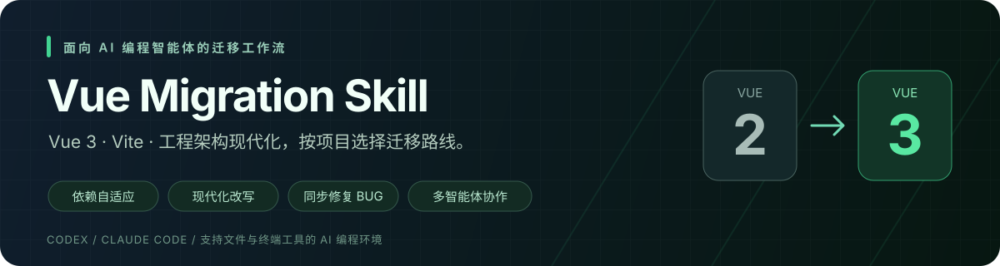

<p align="center">
  
</p>

<p align="center">
  <a href="https://github.com/EasyTZ/vue-migration-skill/actions/workflows/ci.yml"></a>
  <a href="LICENSE"></a>
  
</p>

<p align="center"><strong>按项目选择依赖 · 按新框架改写代码 · 边迁移边修复 BUG · 多智能体并行推进</strong></p>

<p align="center">
  <a href="#快速开始">快速开始</a> ·
  <a href="#功能一览">功能一览</a> ·
  <a href="#安装到你的智能体">安装到你的智能体</a> ·
  <a href="#迁移如何进行">迁移流程</a> ·
  <a href="https://github.com/EasyTZ/vue-migration-skill/issues">反馈问题</a>
</p>

# Vue Migration Skill

将 Vue 2 项目迁移到现代 Vue 3 的 AI 编程技能。它把项目普查、依赖决策、代码改写、缺陷修复、并行分工和分批验收组织成可持续执行的流程，帮助智能体处理整仓迁移，也能接手已经进行中的迁移工程。

**你提供源工程、目标目录和必要的业务约束，智能体按项目实际情况推进迁移。** UI、请求、状态和构建工具由项目用途及生态兼容性决定；版本在执行时查询，优先改写旧代码以使用最新稳定依赖。

> **预览版**：当前提供迁移规则与辅助工具。辅助脚本已有本地测试，跨智能体及真实项目端到端验证仍需逐步补齐。实际完成状态以运行证据和业务验收为准。

## 快速开始

### 1. 获取 Skill

```sh
git clone https://github.com/EasyTZ/vue-migration-skill.git
```

保留完整目录，尤其是 `SKILL.md`、`references/`、`scripts/` 和 `assets/`。可以先直接指定入口使用，也可以[安装到智能体的技能目录](#安装到你的智能体)。

### 2. 准备迁移环境

| 准备项 | 说明 |
|---|---|
| AI 编程环境 | 能读取和编辑本地文件、运行终端命令；联网和浏览器能力用于版本查证与行为验证 |
| Node.js | 用于运行辅助脚本；CI 配置覆盖 Node 22/24。目标工程的运行时按依赖要求另行选择 |
| 源工程 | 完整源码、依赖清单和锁文件；可运行的旧工程更利于建立行为基线 |
| 目标目录 | 与源工程并列的独立目录；已有迁移项目可直接续作 |
| 验收条件 | 已有测试、关键操作流程、测试环境及获准使用的数据；缺失项由智能体先核查再记录 |

本仓库辅助脚本使用 Node 内置模块，无需先执行 `npm install`。目标项目的业务依赖由迁移过程另行安装。

### 3. 发送迁移任务

将路径替换成实际的绝对路径，然后把下面的任务交给智能体：

```text
请完整读取 <Skill目录>/SKILL.md，并按需读取引用文件，执行 Vue 2 → Vue 3 迁移。

源工程：<源工程绝对路径>
目标工程：<目标工程绝对路径>

先检查宿主能力、项目规则、依赖及实际使用点，再确定目标技术路线。
执行时核验最新稳定依赖，按目标框架推荐方式改写旧代码。
迁移过程中排查并修复有证据、正确预期明确的 BUG，补充回归验证。
保留源工程既有文件；过程资料放源工程 migration 控制目录。
支持子代理时，按独立模块并行执行，共享配置和锁文件统一管理。
先验证公共能力与代表链路，再逐批迁移，并持续更新台账和检查点。
报告实际执行的检查、证据及待验收项，业务规则不明确时集中提出问题。
```

默认控制目录是 `<源工程>/migration/`。源工程不可写或需放到工程外时，在任务中另行指定控制目录。

## 功能一览

| 能力 | 具体做什么 | 输出什么 |
|---|---|---|
| 🔎 项目普查 | 阅读清单、锁文件、入口、调用链和部署配置；识别旧语法及候选风险 | 源码快照、入口清单、风险与前置条件 |
| 🧩 依赖自适应 | 按真实用途决定升级、替换、删除或新增；核验维护状态、稳定版本及 peer/engine 约束 | 依赖映射、版本矩阵、选择依据 |
| ✨ 现代化改写 | 使用 Vue 3 组合式能力，拆解隐式依赖和 mixin，更新组件、路由、状态及构建调用 | 符合目标生态的源码与配置 |
| 🛠️ 同步修复 BUG | 检查空值、竞态、重复提交、校验、资源释放和会话残留；确认后修复 | 缺陷记录、修复差异、回归证据 |
| ⚡ 多代理协作 | 按依赖关系拆分独立模块，分配文件所有权，统一集成共享配置 | 可追踪的任务分工与集成结果 |
| 🧪 分批验证 | 执行适用的静态检查、测试、构建、SFC 编译、行为与视觉对拍 | 每批实际结果、允许差异及验收缺口 |
| 🧭 中断续作 | 持久化当前批次、改动、失败项、命令及下一步 | 可恢复的检查点和迁移台账 |

### 依赖选择随项目而定

Skill 的目标是 Vue 3，周边生态由项目需求决定：

- 原库有受维护的目标版本：升级依赖，并改写所有受影响的调用点。
- 原库停更或不兼容：评估可维护的替代方案，验证能力覆盖及行为差异。
- 原依赖已无实际用途：确认动态调用和副作用后移除。
- 目标工程需要新能力：说明用途后补充依赖，避免照搬旧清单或固定模板。

JS/TS、SPA、SSR、组件库、微前端及 workspace 均按原项目与用户目标设计。精确版本和锁文件保证本次迁移可复现；每个新项目重新核验版本。稳定生态存在无法解决的冲突时，会列出证据和选择，偏离最新稳定目标需明确接受。

### BUG 修复有依据、有回归

改写时同步阅读源实现及调用方，区分源缺陷、迁移引入缺陷和待证实疑点。可确定的崩溃、竞态、资源泄漏等直接在目标工程修复，并检查同类调用点；金额、权限、审批等规则不明确时，先查依据再集中确认。

每项修复记录触发条件、正确预期、影响范围及实际验证结果。新旧对拍对已确认修复的部分采用正确预期，其他行为继续回归。详见 [BUG 修复规范](references/bug-fixing.md)。

## 安装到你的智能体

仓库名为 `vue-migration-skill`，技能标识为 **`vue2-to-vue3-migration`**。安装目录使用技能标识，保留整个 Skill 的支持文件。

| 环境 | 项目内安装目录 | 用户级安装目录 |
|---|---|---|
| Codex 本地环境 | `.agents/skills/vue2-to-vue3-migration/` | `~/.agents/skills/vue2-to-vue3-migration/` |
| Claude Code 本地环境 | `.claude/skills/vue2-to-vue3-migration/` | `~/.claude/skills/vue2-to-vue3-migration/` |
| DeepSeek 及其他模型 | 根据实际 CLI、IDE 插件或智能体框架的加载机制安装 | 根据宿主支持决定 |

> 安装 Skill 是环境准备步骤；迁移开始后，源工程既有文件保持只读。需要严格冻结源工程时，优先使用用户级安装或工程外的显式入口。

**Codex**：将完整目录放到上表位置，确认技能已被发现，再通过技能选择入口或显式要求读取 `SKILL.md`。作用域和加载机制见 [Codex 官方说明](https://learn.chatgpt.com/docs/build-skills)。

**Claude Code**：放到对应目录后，通过 `/vue2-to-vue3-migration` 附上源/目标路径与任务要求。更多作用域见 [Claude Code 官方说明](https://code.claude.com/docs/en/skills)。

**DeepSeek 及其他宿主**：是否支持 Skill、终端和多代理由承载工具决定。没有自动发现能力时，直接使用[快速开始](#快速开始)中的提示词，指定 `SKILL.md` 的实际路径。

启动后会检测文件、终端、联网、浏览器、子代理及持久化能力。支持并行时使用子代理，缺少能力时按实际情况串行推进或记录待验证范围。详见[平台适配](references/platform-adapters.md)。

## 迁移如何进行


| 阶段 | 智能体的主要工作 | 检查重点 |
|---|---|---|
| ① 了解工程 | 读取宿主及项目规则，检查环境、入口、依赖与运行契约 | 可用工具、浏览器、外部服务、源工程基线 |
| ② 确定路线 | 推导目标依赖，查询稳定版本，识别破坏性变更与替代路线 | 依赖兼容、部署约束、JS/TS 及运行形态 |
| ③ 建立基础 | 初始化目标工程，按实际需求接入请求、权限、路由和共享能力 | 公共契约和代表链路先验证 |
| ④ 逐批迁移 | 分配独立模块，现代化改写并排查源缺陷 | 输入输出、副作用、文件所有权及修复证据 |
| ⑤ 集成验收 | 执行项目适用检查和新旧对拍，验证生产构建与部署行为 | 跨模块链路、入口覆盖及未完成项 |

子代理数量按可用资源和模块耦合决定。依赖清单、锁文件、共享路由、根配置及总台账由指定负责人统一管理；合入后必须重新做整体验证。详见[并行迁移规则](references/parallel-migration.md)。

### 迁移结束后得到什么

```text
工作目录/
├── legacy-project/             源工程，既有文件保持只读
│   └── migration/              默认控制目录
│       ├── project.json        本次迁移配置
│       ├── 迁移规范.md          版本矩阵、契约与改写约定
│       ├── 迁移台账.md          文件对应、BUG、状态与证据
│       ├── 迁移计划书.md        批次、依赖关系与验收安排
│       ├── 检查点.md            中断续作状态
│       ├── inventory/          普查快照
│       ├── evidence/           截图、日志与验收证据
│       └── tools/              迁移专用工具
└── modern-project/             可独立维护的目标工程
    ├── 项目源码与入口
    ├── 项目测试与构建配置
    ├── package.json 与锁文件
    └── README 与无凭证配置示例
```

交付分别报告 **代码已迁移、自动验证通过、对拍通过、人工验收通过**。缺少后端、现场环境或业务确认时，会说明对应缺口，保留实际状态。过程资料和敏感证据留在控制目录，目标工程只承载项目自身内容。

## 常用任务示例

<details>
<summary><strong>接手已经进行中的迁移</strong></summary>

```text
读取 <Skill目录>/SKILL.md。
源工程：<源路径>；目标工程：<目标路径>；控制目录：<控制路径>。
先读取迁移规范、台账及检查点，核对实际文件和已有证据。
保留人工修改和已完成状态，不重新初始化目标工程。
从未完成批次继续；核验依赖决策与最新状态后，再开展独立模块并行工作。
```

</details>

<details>
<summary><strong>先完成普查与依赖方案，再决定执行范围</strong></summary>

```text
使用此 Skill 对 <源工程路径> 做迁移普查，本次先不改写业务代码。
建立控制目录，识别入口、依赖用途、旧 API、候选缺陷和部署约束。
查询目标稳定版本，给出依赖映射、替代方案、批次顺序及验证缺口。
区分已确认问题与待证实风险，结果写入控制目录。
```

</details>

<details>
<summary><strong>为大型工程启用并行迁移</strong></summary>

```text
使用此 Skill 迁移 <源路径> 到 <目标路径>。
先完成依赖决策和公共契约，验证代表链路，再按独立业务模块分派子代理。
每个任务明确可写文件、禁止修改项、前置接口和验收场景。
共享配置和锁文件由主代理统一管理；汇总缺陷修复证据，集成后全量验证。
```

</details>

## 辅助工具与配置

正常使用时，由智能体根据流程调用工具；需要手动检查时，可在终端执行下表命令。路径替换成实际值，含空格时保留引号。

| 工具 | 命令 | 行为 |
|---|---|---|
| 控制目录初始化 | `node "<Skill目录>/scripts/init-control.mjs" "<源工程>" [控制目录]` | 默认创建源工程顶层 `migration/`，保留已有文件 |
| 源码普查 | `node "<Skill目录>/scripts/inventory.mjs" "<源工程>" "<控制目录>/inventory/source-01.json"` | 生成源码与候选风险快照，拒绝覆盖已有快照 |
| 目标清单初始化 | `node "<Skill目录>/scripts/init-target.mjs" "<目标工程>" "<控制目录>/project.json"` | 只生成 `package.json`、README 和 `.gitignore`；不安装依赖、不生成固定骨架 |
| SFC 巡检 | `node "<Skill目录>/scripts/check-sfc.mjs" "<目标工程>"` | 使用目标工程的编译器检查 `src/` 下的 `.vue` 文件 |
| 工程边界检查 | `node "<Skill目录>/scripts/check-boundary.mjs" "<控制目录>" "<目标工程>"` | 报告误放的过程资料和候选问题，不自动移动文件 |

初始化目标清单前，需按[配置结构](assets/project.example.json)填写控制目录的 `project.json`：

| 字段 | 用途 |
|---|---|
| `sourceRoot` / `targetRoot` / `control.root` | 实际源、目标和控制目录；相对路径以控制目录解析 |
| `packageManager` / `packageManagerVersion` / `nodeVersion` | 本项目选择的安装与运行环境 |
| `targetManifest` | 目标 `package.json` 的真实内容，包括名称、脚本、依赖及所需扩展字段 |
| `dependencyPolicy` / `dependencyDecisions` | 版本核验信息、源依赖用途、升级/替换/删除决定与依据 |
| `contracts` / `routing` / `baseline` | 项目实际存在的接口、业务、路由与运行基线 |
| `verification` / `acceptedDifferences` / `pendingDecisions` | 检查场景、已接受差异及待定事项 |

目标初始化器要求目录为空且位于源工程、控制目录之外；已有目标工程直接续作。外部安装依赖使用核验后的稳定精确版本，库的 peer 范围和 workspace 协议保留真实契约。特殊声明不被初始化器支持时，可按目标技术路线手动建工程并记录依据。

SFC 巡检需预先安装与目标 Vue 编译链匹配的编译器及所需预处理器。SSR、monorepo 或特殊源码目录应补充对应验证；一次 `src/` 扫描不能代表整仓编译覆盖。所有工具的通过结果均不能代替实际业务运行与验收。

## 验证状态

| 范围 | 状态 |
|---|---|
| 辅助脚本本地测试 | Windows / Node 22.21.1：14 项，13 通过、1 项不适用跳过，0 失败 |
| 跨系统 CI | 已配置 Windows、Linux、macOS × Node 22/24；实际结果见顶部 CI 徽章与 [Actions](https://github.com/EasyTZ/vue-migration-skill/actions) |
| Codex 文件操作与子代理 | 本仓库维护过程已使用；完整项目迁移需另行验证 |
| Claude Code、搭载 DeepSeek 的宿主 | 已提供平台适配规则，实际执行待验证 |
| 真实业务项目端到端迁移 | 暂无公开验证报告 |

在仓库根目录运行：

```sh
node --test
```

测试覆盖脚本语法、文档引用、初始化不覆盖、源文件保护、依赖清单透传、工程边界及错误路径。智能体评测方法见 [EVALUATION.md](EVALUATION.md)。

## 文档导航

| 想了解什么 | 从这里开始 |
|---|---|
| 完整执行流程 | [SKILL.md](SKILL.md) |
| 项目普查与工程约束 | [准入与普查](references/assessment.md) |
| 最新稳定依赖如何选择 | [依赖策略](references/dependency-policy.md) |
| 目标工程如何组织 | [目标工程契约](references/target-template.md) |
| 旧写法与组件适配要点 | [兼容性检查](references/compatibility.md) |
| 贡献规则与变更记录 | [贡献指南](CONTRIBUTING.md) · [版本记录](CHANGELOG.md) |

欢迎通过 [Issue](https://github.com/EasyTZ/vue-migration-skill/issues) 提交脱敏最小复现，或通过 PR 补充规则、测试和平台验证。安全问题请按 [SECURITY.md](SECURITY.md) 非公开报告，勿上传凭证、真实业务数据或未经允许的源码。

本仓库采用 [MIT 许可证](LICENSE)。迁移源项目和第三方依赖继续遵守各自的许可证与使用约定。
